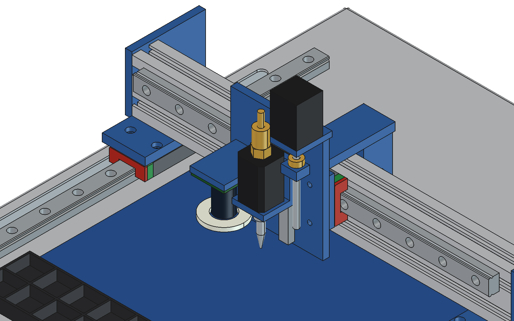
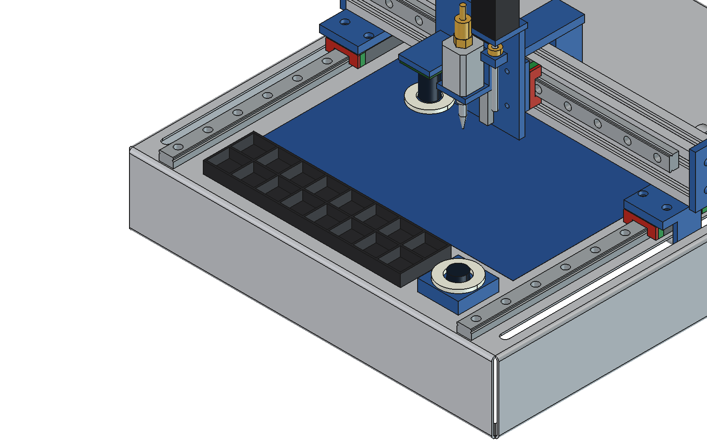
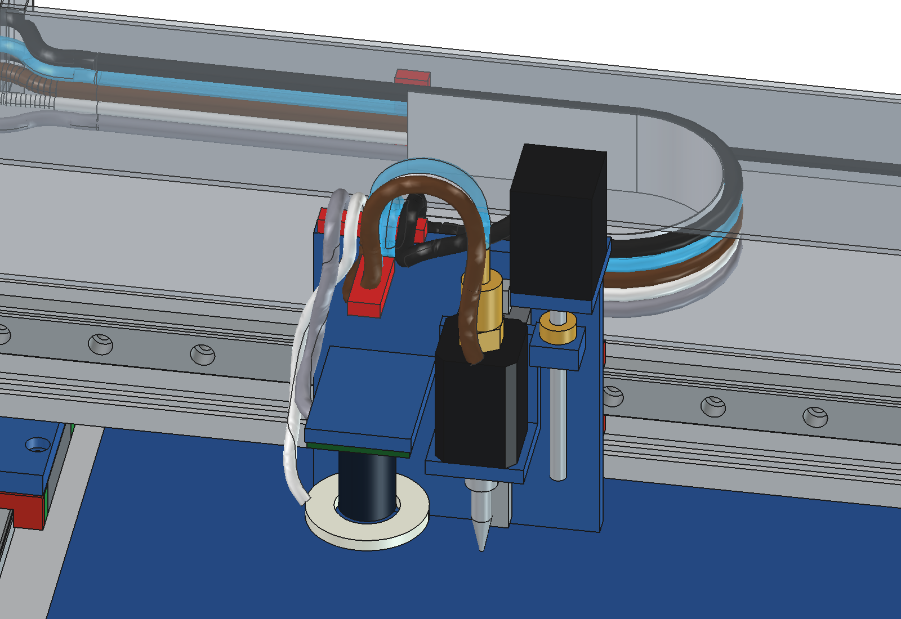
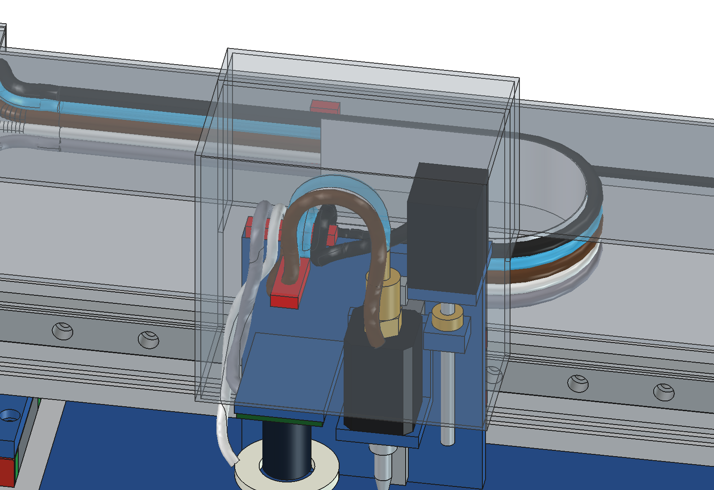
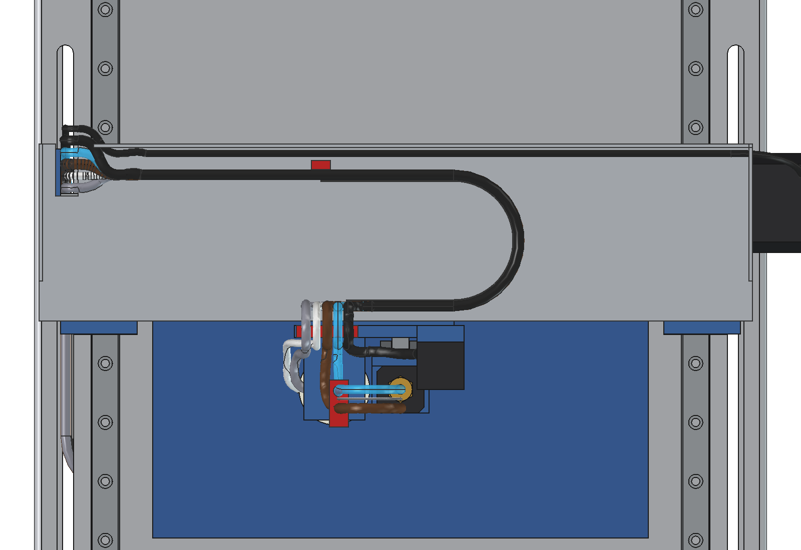
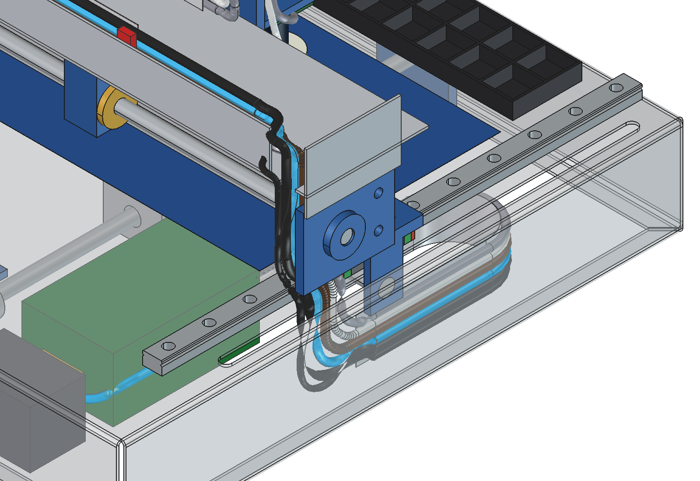
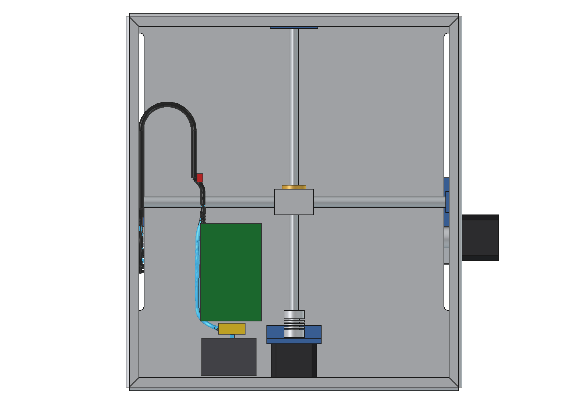

<div align="center">
  

  <br />

  # A5 Pick & Place
  **Grande precisione, area di lavoro A5.**

  [](./LICENSE)
  [](#)
  [-slate.svg)](#area-di-lavoro-e-corse)

  [Modello 3D](#modello-3d) • [Parti da acquistare](#parti-meccaniche-da-acquistare) • [Scelte di progetto](#scelte-di-progetto) • [Specifiche](#specifiche) • [Licenza](#licenza)
</div>

---

## Modello 3D

<div align="center">
  
</div>

| Vista posteriore (motore e vite X) | Vista da sotto (trascinamento Y) |
| :---: | :---: |
|  |  |

| Testa di piazzamento (FreeCAD) | Parte frontale: vassoio e telecamera dal basso (FreeCAD) |
| :---: | :---: |
|  |  |

- **[Modello FreeCAD parametrico](./hardware/cad/A5ive_pick_and_place.FCStd):** il modello di riferimento, costruito da zero in FreeCAD 1.1 con PartDesign e già comprensivo di testa e parte frontale. Tutte le quote sono nel foglio *Parametri*: cambiando un valore (area di lavoro, margini, lamiera, rotaie…) il modello si aggiorna. Con `carrello_x`, `carrello_y` e `z_nozzle` gli assi si muovono lungo la corsa.
- **[Generatore FreeCAD](./hardware/freecad/):** gli script che ricreano il modello da zero. In FreeCAD si lancia `genera_a5ive.py` da *Macro → Macro…*.
- **[Modello STEP](./hardware/cad/A5ive_pick_and_place.step) e [STL](./hardware/cad/A5ive_pick_and_place.stl):** esportati dal modello FreeCAD, comprendono testa, parte frontale e la bozza del passaggio cavi. Lo STL si apre nel visualizzatore 3D di GitHub.
- **Sorgente Fusion:** progetto cloud *Pick and Place A5*, documento *Pick and Place A5* (fermo a prima della testa; il modello di riferimento ora è quello FreeCAD).

> Il progetto è in corso. Sono pronti telaio, asse Y, asse X, testa con asse Z, nozzle rotante e telecamere, vassoio per componenti sfusi e una bozza del passaggio di cavi e tubo del vuoto. Mancano ancora i feeder a nastro.

### Passaggio cavi e tubo del vuoto (bozza)

L'obiettivo è non avere catene portacavi a vista: tutti i cavi e il tubo corrono dentro canali e carter. Sulla testa **non c'è nessuna scheda**: ogni cavo esce così com'è dal suo componente (motore Z, motore di rotazione, telecamera USB, anello LED) insieme al tubo del vuoto da 4 mm.

| Testa senza carter | Testa con carter (trasparente) |
| :---: | :---: |
|  |  |

| Canale sul gantry, visto dall'alto | Discesa nell'asola sinistra | Base vista da sotto |
| :---: | :---: | :---: |
|  |  |  |

1. **Asse Z.** Tubo e cavo del motore di rotazione salgono e scendono con l'ugello: sopra il raccordo KSH04 fanno un'ansa a "n" (raggio 13 mm), bloccata da un fermacavo sul carter della testa.
2. **Uscita dalla testa.** I cinque cavi salgono lungo la piastra, la scavalcano affiancati e scendono nel canale dietro la testa.
3. **Asse X.** In un canale di lamiera sopra il gantry i cavi, impilati su una lamina di acciaio armonico, fanno un'ansa a U orizzontale (raggio 28 mm) con il punto fisso a metà corsa, come nelle stampanti a getto d'inchiostro. Nel canale passa anche il cavo del motore X.
4. **Discesa.** A sinistra i cavi scendono in fila dietro la vite X, sotto un carter, e passano nell'asola sinistra del piano subito dietro la linguetta della staffa Y.
5. **Asse Y.** Sotto il piano c'è una seconda ansa a U orizzontale (raggio 25 mm), sempre su lamina, che curva verso il davanti.
6. **Base.** Dopo il fermacavo i cavi vanno alla scheda di controllo con i driver, il tubo va a elettrovalvola e sensore del vuoto e poi alla pompa, tutto dentro il telaio.

Punti ancora aperti:

- con il carrello Y tutto indietro la fila di cavi esce dalla fine dell'asola sinistra: l'asola va allungata di circa 40 mm verso il retro (da Y = +100 a circa +140), oppure serve un'asola dedicata ai cavi;
- la bozza è disegnata solo con gli assi in posizione zero e non segue ancora i parametri del modello;
- i cavi devono essere adatti alla flessione continua (tipo per catene portacavi).

La bozza si ricrea con [`fc_proposta_cavi.py`](./hardware/freecad/fc_proposta_cavi.py), con il modello aperto in FreeCAD.

## Promemoria acquisti

- **Kit testina SMT per il nozzle:** [motore NEMA8/NEMA11 ad albero cavo con ugello Juki e raccordo girevole KSH04-M5 (AliExpress)](https://it.aliexpress.com/item/1005004594670502.html). È il componente scelto per la rotazione a 360° del nozzle; nel modello è la versione **NEMA8**. Le misure del motore (`nema8_l` nel foglio Parametri) vanno verificate sul pezzo arrivato.

## Parti meccaniche da acquistare

Quantità e misure prese dal modello 3D.

| # | Parte | Specifica | Q.tà | Dove va |
| :-: | :--- | :--- | :-: | :--- |
| 1 | Rotaia guida lineare | MGN12, **L = 295 mm** (lunghezza standard HIWIN) | 2 | Asse Y, ai lati dell'area A5 |
| 2 | Rotaia guida lineare | MGN12, **L = 270 mm** (lunghezza standard HIWIN) | 1 | Asse X, sulla faccia anteriore del profilo |
| 3 | Pattino a ricircolo di sfere | MGN12H (lungo), 27 × 45,4 mm, 4 fori M3 | 3 | 2 asse Y, 1 asse X |
| 4 | Vite trapezia | T8 passo 8 (4 principi), Ø 8 mm, L ≈ 280 mm | 2 | Asse Y (sotto il piano) e asse X (dietro il profilo) |
| 5 | Chiocciola | T8x8 in ottone, flangiata Ø 22 mm | 2 | Blocchi chiocciola X e Y |
| 6 | Giunto elastico | 5 × 8 mm, Ø 19 × 25 mm | 2 | Motore → vite, assi X e Y |
| 7 | Motore passo-passo | NEMA17, 42 × 42 × 40 mm, albero Ø 5 mm | 2 | Asse Y (dietro, sotto il piano), asse X (lato destro) |
| 8 | Cuscinetto | 608ZZ (8 × 22 × 7 mm) | 2 | Supporto lato libero delle viti |
| 9 | Profilo alluminio | 2040 cava 6, **L = 288 mm** | 1 | Traversa del gantry X |
| 10 | Barra tonda acciaio | Ø 10 mm, **L = 288 mm** | 1 | Asta che unisce i due pattini Y sotto il piano |
| 11 | Dadi a T | M3 per cava 6 | 15 | Rotaia X e fissaggio profilo sulle staffe |
| 12 | Viteria | M3 (rotaie, pattini, motori), M5 (testate profilo) | — | Tutta la macchina |
| 13 | Kit testina SMT | NEMA8 ad albero cavo + adattatore ugelli Juki + raccordo girevole KSH04-M5 ([link](https://it.aliexpress.com/item/1005004594670502.html)) | 1 | Rotazione del nozzle a 360° |
| 14 | Ugelli | Juki serie 500, set di misure per 0402 … QFP | 1 set | Sotto il motore ad albero cavo |
| 15 | Motore passo-passo lineare | NEMA8 con vite T4 integrata e chiocciola | 1 | Asse Z, in cima alla testa |
| 16 | Rotaia guida lineare | MGN7, **L = 70 mm** | 1 | Asse Z, verticale sulla piastra testa |
| 17 | Pattino a ricircolo di sfere | MGN7H, 17 × 30,8 mm | 1 | Asse Z |
| 18 | Telecamera USB | Scheda 25 × 25 mm con obiettivo M12 | 2 | Testa (verso il basso) e fronte (dal basso) |
| 19 | Anello LED | Ø 30–32 mm, foro Ø 16–18 mm | 2 | Intorno ai due obiettivi |
| 20 | Tubo pneumatico | PU 4 × 2,5 mm | ≈ 1,5 m | Dal raccordo girevole all'impianto del vuoto |
| 21 | Cavi per flessione continua | 4 poli (3 motori), 2 poli (anello LED), USB (telecamera) | ≈ 1,5 m ciascuno | Dalla testa alla scheda di controllo |
| 22 | Lamina di acciaio armonico | 0,2 mm, larga circa 25 mm | 2 | Guida delle anse a U degli assi X e Y |
| 23 | Pompa del vuoto, elettrovalvola e sensore del vuoto | Pompa a membrana | 1 | Nella base, sotto il piano |

### Parti da realizzare

| Parte | Materiale | Q.tà |
| :--- | :--- | :-: |
| Telaio 310 × 348 × 60 mm, bordi piegati due volte, asole 7 mm per le linguette | Lamiera di alluminio 1,5 mm | 1 |
| Staffa pattino Y con linguetta che scende nell'asola | Alluminio 6 mm | 2 |
| Blocco chiocciola Y (porta chiocciola e asta Ø 10) | Alluminio | 1 |
| Supporto anteriore vite Y e piastra motore Y | Alluminio | 2 |
| Testate profilo X (lato cuscinetto e lato motore) | Alluminio 5 mm | 2 |
| Ponte pattino X → chiocciola (scavalca il profilo) | Alluminio | 1 |
| Piastra testa e mensola del motore Z | Alluminio 5 mm / 4 mm | 2 |
| Supporto Z: piastra sul pattino, mensola del motore rotante, orecchio della chiocciola | Alluminio 4 mm | 1 |
| Braccio della telecamera verso il basso | Alluminio 4 mm | 1 |
| Vassoio 16 scomparti (2 × 8, 19 × 19 mm) | Stampa 3D, materiale antistatico | 1 |
| Supporto della telecamera dal basso | Alluminio o stampa 3D | 1 |
| Canale cavi sopra il gantry, con coperchio | Lamiera di alluminio 1,5 mm | 1 |
| Carter della testa e carter della discesa cavi | Lamiera sottile o stampa 3D | 2 |

## Scelte di progetto

- **Area di lavoro grande come un foglio A5 (210 × 148 mm).** Tutta la macchina è dimensionata attorno a quest'area, con il minimo ingombro: 310 × 348 mm di base.
- **Niente cinghie.** Le cinghie si allentano, perdono tensione e non sono abbastanza precise. Tutti gli assi si muovono con **viti trapezie T8**, con il motore collegato direttamente in asse tramite un giunto elastico, senza pulegge.
- **Solo guide lineari a ricircolo di sfere.** Le guide MGN12 con pattini MGN12H sono rigide e senza gioco, e non usano aste lisce, bronzine o ruote. Le lunghezze delle rotaie sono quelle standard HIWIN.
- **Una sola vite per l'asse Y.** Sotto i pattini Y ci sono due staffe con una linguetta che passa da un'asola nel piano e scende sotto. Sotto il piano, un'asta Ø 10 unisce le due linguette, e una vite centrale le muove insieme. Così bastano un motore e una vite, e il gantry non si può storcere.
- **Meccanica Y nascosta nel telaio.** Il telaio è in lamiera piegata due volte, quindi senza bordi taglienti, e alto 60 mm. Dentro ci stanno vite, chiocciola, asta e motore Y, protetti dalla polvere e dai componenti che cadono.
- **Gantry X rigido e basso.** Il profilo 2040 è in piedi, la rotaia sta sulla faccia anteriore e la vite dietro al profilo. Un ponte che scavalca il profilo collega il pattino alla chiocciola. Il motore X è sul lato destro.
- **Si accetta una corsa un po' più corta** per evitare le cinghie, ma l'area A5 resta coperta tutta.
- **Nozzle più piccolo possibile, che gira a 360°.** Motore NEMA8 ad albero cavo: il vuoto passa dentro l'albero e un raccordo girevole KSH04-M5 in cima permette giri infiniti senza attorcigliare il tubo. Sotto c'è direttamente l'ugello Juki, senza ingranaggi né cinghie.
- **Asse Z a vite, come X e Y.** Un NEMA8 lineare con vite T4 muove un pattino MGN7H su una mini guida MGN7: 25 mm di corsa, senza gioco.
- **Telecamera verso il basso solidale alla testa.** È fissata alla piastra della testa, accanto al nozzle: si muove con lui in X e Y ma non sale e scende con lo Z, così resta sempre a fuoco sul piano. Ha un anello LED intorno all'obiettivo.
- **Parte frontale per i componenti sfusi.** Davanti all'area A5 ci sono un vassoio da 16 scomparti e la telecamera dal basso con anello LED, che controlla posizione e rotazione del componente preso dal nozzle.
- **Area A5 spostata in avanti di 35 mm.** Il nozzle sta davanti alla traversa X: spostando l'area A5 (parametro `a5_y_centro`) il nozzle la raggiunge tutta senza allungare il telaio.

## Specifiche

| Parametro | Valore |
| :--- | :--- |
| **Area di lavoro** | 210 × 148 mm (formato A5) |
| **Ingombro base** | 310 × 348 × 60 mm (gantry escluso) |
| **Corsa Y** | 230,5 mm (gantry da −143,5 a +87 mm dal centro del telaio) |
| **Corsa X** | 219,3 mm (pattino da −112,3 a +107 mm dal centro del telaio) |
| **Corsa Z** | 25 mm, NEMA8 lineare con vite T4 su guida MGN7 |
| **Rotazione nozzle** | 360° continua, NEMA8 ad albero cavo con raccordo girevole KSH04-M5 |
| **Telecamere** | Una sulla testa (verso il basso) e una sul fronte (dal basso), entrambe con anello LED |
| **Trasmissione** | Viti T8x8 in presa diretta, nessuna cinghia |
| **Guide** | MGN12 con pattini MGN12H |
| **Risoluzione teorica** | 0,0025 mm/micropasso (NEMA17 1,8°, 1/16 di micropasso, passo 8 mm) |
| **Componenti previsti** | da `0402` a `QFP` / `SOIC` |
| **Firmware controller** | Smoothieware / GRBL / Duet3D |
| **Software host** | [OpenPnP](https://openpnp.org/) |
| **Alimentazione** | 24 V DC |

### Area di lavoro e corse

Le quote sono misurate dal centro del telaio; Y positivo va verso il retro.

| Zona | X [mm] | Y [mm] |
| :--- | :--- | :--- |
| Area A5 (spostata in avanti di 35 mm) | −105 … +105 | −109 … +39 |
| Raggiunta dal nozzle | −112,3 … +107 | −189,5 … +41 |
| Vista dalla telecamera sulla testa (28 mm a sinistra del nozzle) | −140,3 … +79 | −189,5 … +41 |
| Vassoio 16 scomparti | −102,8 … +62,8 | −161,3 … −118,8 |
| Telecamera dal basso | +73 … +107 | −157 … −123 |

Il nozzle raggiunge tutta l'area A5, il vassoio e la telecamera dal basso. La telecamera sulla testa non vede la striscia destra dell'A5 (da X = +79 a +105): conviene mettere i riferimenti del PCB (fiducial) nella parte sinistra, oppure spostare la telecamera con il parametro `cam_dx`.

## Struttura del repository

```text
├── hardware/
│   ├── cad/      # Modello 3D: FCStd parametrico FreeCAD, STEP e STL esportati da FreeCAD
│   ├── freecad/  # Script che rigenerano il modello FreeCAD da zero
│   └── img/      # Viste del modello
├── logo.svg    # Banner del progetto
└── LICENSE
```

## Licenza

Distribuito con licenza **MIT**. Vedi [`LICENSE`](./LICENSE).
