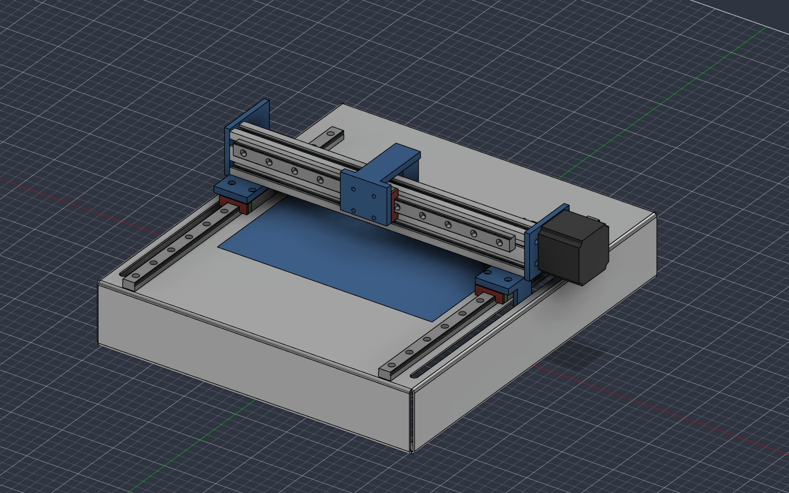
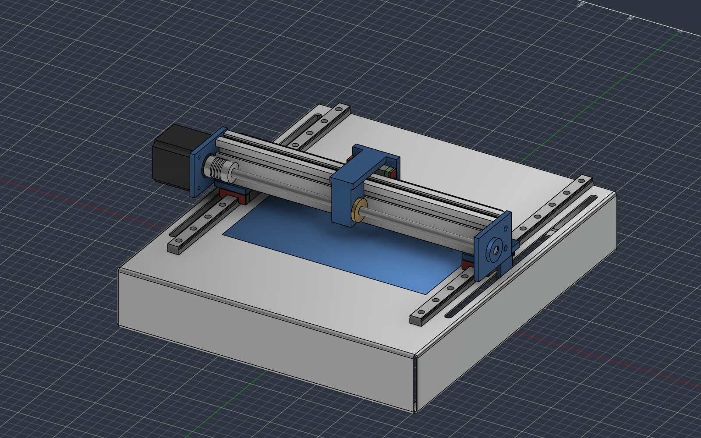
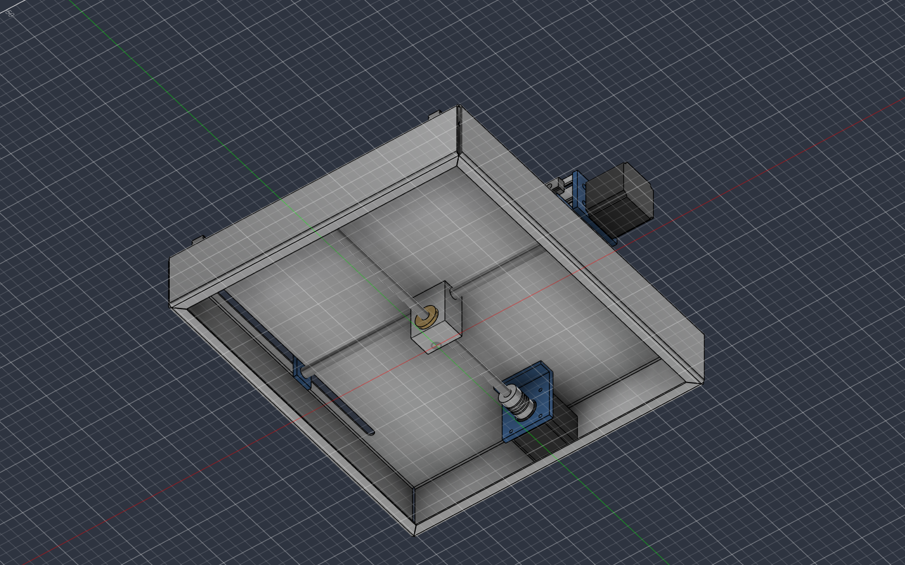

<div align="center">
  

  <br />

  # A5 Pick & Place
  **Grande precisione, area di lavoro A5.**

  [](./LICENSE)
  [](#)
  [-slate.svg)](#area-di-lavoro-e-corse)

  [Modello 3D](#modello-3d) • [Parti da acquistare](#parti-meccaniche-da-acquistare) • [Scelte di progetto](#scelte-di-progetto) • [Specifiche](#specifiche) • [Licenza](#licenza)
</div>

---

## Modello 3D

<div align="center">
  
</div>

| Vista posteriore (motore e vite X) | Vista da sotto (trascinamento Y) |
| :---: | :---: |
|  |  |

- **[Modello STEP](./hardware/cad/A5ive_pick_and_place.step):** l'assieme completo da aprire in qualsiasi CAD (Fusion, FreeCAD, SolidWorks, Inventor).
- **[Modello STL](./hardware/cad/A5ive_pick_and_place.stl):** si apre nel visualizzatore 3D di GitHub, dove si può ruotare e ingrandire.
- **Sorgente Fusion:** progetto cloud *Pick and Place A5*, documento *Pick and Place A5*.

> Il progetto è in corso. Sono pronti telaio, asse Y e asse X. Mancano ancora testa con asse Z, ugello, telecamere e feeder.

## Parti meccaniche da acquistare

Quantità e misure prese dal modello 3D.

| # | Parte | Specifica | Q.tà | Dove va |
| :-: | :--- | :--- | :-: | :--- |
| 1 | Rotaia guida lineare | MGN12, **L = 295 mm** (lunghezza standard HIWIN) | 2 | Asse Y, ai lati dell'area A5 |
| 2 | Rotaia guida lineare | MGN12, **L = 270 mm** (lunghezza standard HIWIN) | 1 | Asse X, sulla faccia anteriore del profilo |
| 3 | Pattino a ricircolo di sfere | MGN12H (lungo), 27 × 45,4 mm, 4 fori M3 | 3 | 2 asse Y, 1 asse X |
| 4 | Vite trapezia | T8 passo 8 (4 principi), Ø 8 mm, L ≈ 280 mm | 2 | Asse Y (sotto il piano) e asse X (dietro il profilo) |
| 5 | Chiocciola | T8x8 in ottone, flangiata Ø 22 mm | 2 | Blocchi chiocciola X e Y |
| 6 | Giunto elastico | 5 × 8 mm, Ø 19 × 25 mm | 2 | Motore → vite, assi X e Y |
| 7 | Motore passo-passo | NEMA17, 42 × 42 × 40 mm, albero Ø 5 mm | 2 | Asse Y (dietro, sotto il piano), asse X (lato destro) |
| 8 | Cuscinetto | 608ZZ (8 × 22 × 7 mm) | 2 | Supporto lato libero delle viti |
| 9 | Profilo alluminio | 2040 cava 6, **L = 288 mm** | 1 | Traversa del gantry X |
| 10 | Barra tonda acciaio | Ø 10 mm, **L = 288 mm** | 1 | Asta che unisce i due pattini Y sotto il piano |
| 11 | Dadi a T | M3 per cava 6 | 15 | Rotaia X e fissaggio profilo sulle staffe |
| 12 | Viteria | M3 (rotaie, pattini, motori), M5 (testate profilo) | — | Tutta la macchina |

### Parti da realizzare

| Parte | Materiale | Q.tà |
| :--- | :--- | :-: |
| Telaio 310 × 348 × 60 mm, bordi piegati due volte, asole 7 mm per le linguette | Lamiera di alluminio 1,5 mm | 1 |
| Staffa pattino Y con linguetta che scende nell'asola | Alluminio 6 mm | 2 |
| Blocco chiocciola Y (porta chiocciola e asta Ø 10) | Alluminio | 1 |
| Supporto anteriore vite Y e piastra motore Y | Alluminio | 2 |
| Testate profilo X (lato cuscinetto e lato motore) | Alluminio 5 mm | 2 |
| Ponte pattino X → chiocciola (scavalca il profilo) | Alluminio | 1 |

## Scelte di progetto

- **Area di lavoro grande come un foglio A5 (210 × 148 mm).** Tutta la macchina è dimensionata attorno a quest'area, con il minimo ingombro: 310 × 348 mm di base.
- **Niente cinghie.** Le cinghie si allentano, perdono tensione e non sono abbastanza precise. Tutti gli assi si muovono con **viti trapezie T8**, con il motore collegato direttamente in asse tramite un giunto elastico, senza pulegge.
- **Solo guide lineari a ricircolo di sfere.** Le guide MGN12 con pattini MGN12H sono rigide e senza gioco, e non usano aste lisce, bronzine o ruote. Le lunghezze delle rotaie sono quelle standard HIWIN.
- **Una sola vite per l'asse Y.** Sotto i pattini Y ci sono due staffe con una linguetta che passa da un'asola nel piano e scende sotto. Sotto il piano, un'asta Ø 10 unisce le due linguette, e una vite centrale le muove insieme. Così bastano un motore e una vite, e il gantry non si può storcere.
- **Meccanica Y nascosta nel telaio.** Il telaio è in lamiera piegata due volte, quindi senza bordi taglienti, e alto 60 mm. Dentro ci stanno vite, chiocciola, asta e motore Y, protetti dalla polvere e dai componenti che cadono.
- **Gantry X rigido e basso.** Il profilo 2040 è in piedi, la rotaia sta sulla faccia anteriore e la vite dietro al profilo. Un ponte che scavalca il profilo collega il pattino alla chiocciola. Il motore X è sul lato destro.
- **Si accetta una corsa un po' più corta** per evitare le cinghie, ma l'area A5 resta coperta tutta.

## Specifiche

| Parametro | Valore |
| :--- | :--- |
| **Area di lavoro** | 210 × 148 mm (formato A5) |
| **Ingombro base** | 310 × 348 × 60 mm (gantry escluso) |
| **Corsa Y** | 230,5 mm (−143,5 … +87 mm dal centro dell'A5) |
| **Corsa X** | 219,3 mm (−112,3 … +107 mm dal centro dell'A5) |
| **Corsa Z** | 25 mm (da progettare) |
| **Trasmissione** | Viti T8x8 in presa diretta, nessuna cinghia |
| **Guide** | MGN12 con pattini MGN12H |
| **Risoluzione teorica** | 0,0025 mm/micropasso (NEMA17 1,8°, 1/16 di micropasso, passo 8 mm) |
| **Componenti previsti** | da `0402` a `QFP` / `SOIC` |
| **Firmware controller** | Smoothieware / GRBL / Duet3D |
| **Software host** | [OpenPnP](https://openpnp.org/) |
| **Alimentazione** | 24 V DC |

### Area di lavoro e corse

Le quote sono misurate dal centro dell'area A5, che coincide con il centro del telaio. L'area A5 va da −105 a +105 mm in X e da −74 a +74 mm in Y. In Y ci sono quasi 70 mm di corsa in più verso il davanti, dove andranno i feeder.

## Struttura del repository

```text
├── hardware/
│   ├── cad/    # Modello 3D esportato da Fusion (STEP e STL)
│   └── img/    # Viste del modello
├── logo.svg    # Banner del progetto
└── LICENSE
```

## Licenza

Distribuito con licenza **MIT**. Vedi [`LICENSE`](./LICENSE).
