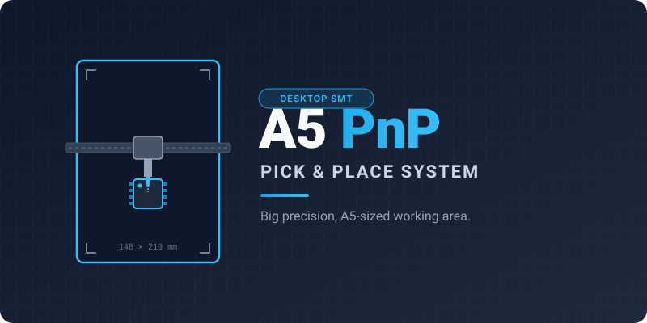

<div align="center">
  

  <br />

  # A5 Pick & Place
  **Big precision, A5-sized working area.**

  [](https://opensource.org/licenses/MIT)
  [](#)
  [-slate.svg)](#)

  [Overview](#overview) • [Key Features](#key-features) • [Specifications](#specifications) • [Getting Started](#getting-started) • [License](#license)
</div>

---

## Overview

**A5 PnP** is a compact, desktop-ready Pick-and-Place machine engineered for rapid PCB prototyping and small-batch SMD assembly. Designed around an **A5-sized working area (148 × 210 mm)**, it delivers industrial-grade placement accuracy while fitting effortlessly on any workbench.

## Key Features

* **Ultra-Compact Footprint:** Full pick-and-place capability within an A5 workspace.
* **High Precision:** Rigid mechanical gantry designed for accurate placement of fine-pitch SMD components (down to `0402` and `QFN`).
* **OpenPnP Compatible:** Seamless integration with [OpenPnP](https://openpnp.org/) for computer vision alignment and job execution.
* **Modular Feeders:** Supports standard 8mm, 12mm, and 16mm tape feeders as well as custom loose-part trays.
* **Dual Vision System:** Upward-looking camera for component centering and downward-looking camera for PCB fiducial recognition.

## Specifications

| Parameter | Value |
| :--- | :--- |
| **Working Area** | $148 \times 210\text{ mm}$ (ISO A5 standard) |
| **Z-Axis Travel** | $25\text{ mm}$ |
| **Placement Resolution** | $\pm 0.02\text{ mm}$ |
| **Supported Components** | `0402` to `QFP` / `SOIC` / `BGA` |
| **Controller Firmware** | Smoothieware / GRBL / Duet3D |
| **Host Software** | OpenPnP |
| **Power Supply** | $24\text{V DC}$ |

## Repository Structure

```text
├── hardware/          # CAD files (STEP, STL) and Bill of Materials (BOM)
├── electronics/       # Custom PCB schematics and wiring diagrams
├── firmware/          # Motion controller configuration files
├── openpnp-config/    # Ready-to-use machine.xml and vision profiles
└── logo.svg           # Project banner
```

## Getting Started

1. **Clone the repository:**
   ```bash
   git clone https://github.com/your-username/a5-pick-and-place.git
   cd a5-pick-and-place
   ```
2. **Review the BOM:** Check `hardware/BOM.csv` for mechanical parts, linear rails, stepper motors, and vacuum pump specifications.
3. **Configure OpenPnP:** Copy the files from `openpnp-config/` into your local `.openpnp2` configuration directory.

## Contributing

Contributions, issues, and feature requests are welcome! Feel free to check the [issues page](../../issues) if you want to contribute to the mechanical design or software profiles.

## License

Distributed under the **MIT License**. See `LICENSE` for more information.